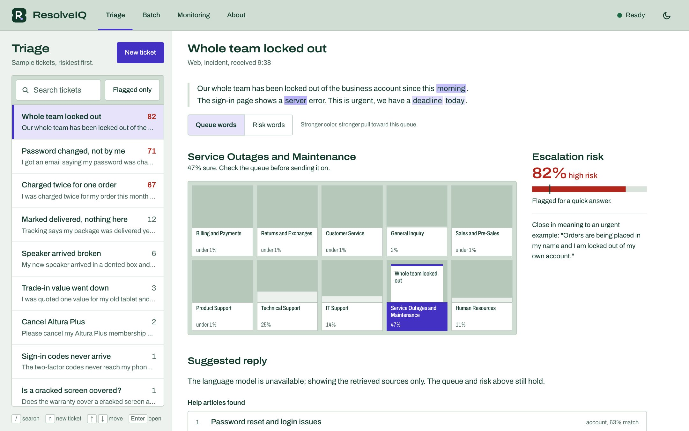

<p align="center">
  <picture>
    <source media="(prefers-color-scheme: dark)" srcset="docs/images/logo-dark.png">
    
  </picture>
</p>

# ResolveIQ: AI Support Ticket Intelligence Platform

Retrieval-augmented reply generation, transformer-based ticket classification and
explainable escalation prediction, delivered through a tested and monitored API.

[](https://github.com/ManasSaxena14/ResolveIQ/actions/workflows/ci.yml)




## The problem

Support agents repeat three steps for every ticket: find the right answer, route the
ticket to the right team, and judge whether it is about to escalate. ResolveIQ does all
three in one call and shows its evidence, so the agent stays in charge:

| Output | Approach |
|---|---|
| Draft reply with page-level citations | Retrieval-augmented generation over the help center |
| Ticket category with confidence and a review flag | Fine-tuned DistilBERT classifier |
| Escalation probability with top reasons | Calibrated XGBoost with SHAP explanations |

Replies are drafts for a person to edit. Nothing is sent automatically.

## Architecture

```
                        +-----------------------------------------+
  support ticket  --->  |  Copilot.analyze   (FastAPI)            |  ---> JSON, React web app
                        +-----------------------------------------+
                           |                 |                  |
                 +---------+-----+   +-------+-------+   +------+----------+
                 | Draft reply   |   | Category      |   | Escalation risk |
                 | Chroma + BM25 |   | DistilBERT    |   | XGBoost + SHAP  |
                 | language model|   | review flag   |   | cost threshold  |
                 +---------------+   +---------------+   +-----------------+
                           |                 |                  |
                        +-----------------------------------------+
                        |  SQLite request log (no ticket text)    |
                        |  drift report, retrain rule, feedback   |
                        +-----------------------------------------+
           MLflow tracking and model registry  |  GitHub Actions CI with a coverage gate
```

If the language model is down, the category and risk are still returned and the draft
is marked unavailable with its sources. Details: [docs/architecture.md](docs/architecture.md).

## Results

All numbers come from logged runs on frozen test sets; the full tables, plots and five
failure cases are in [docs/evaluation_report.md](docs/evaluation_report.md).

| Component | Baseline | ResolveIQ model | Notes |
|---|---|---|---|
| Retrieval (40-question set, holdout) | | 7 of 7 sources found, 0 false refusals | The similarity rule refused 0 of 3 out-of-scope holdout questions |
| Classifier, macro F1 (10 queues) | TF-IDF 0.6333 | DistilBERT 0.5213 (3 seeds: 0.5192 +/- 0.0025) | The transformer is below the baseline; see the analysis |
| Escalation risk, PR-AUC | Base rate 0.3876, logistic regression 0.7435 | XGBoost, calibrated 0.7489 | Alert catches 86.6% of high-priority tickets at a 3 : 1 cost ratio |
| API response time, local | | 43.9 ms median, 49.8 ms p95 | 50 requests, without the language model step |
| Tests | | 88% coverage | Run in CI on every push |

Answer correctness of the drafted replies needs a language model and hand labeling and
has not been measured yet; the report explains how to run it.

## Run it

Requirements: Python 3.12 on macOS or Linux. **Docker is not required.**

```bash
python3.12 -m venv .venv && source .venv/bin/activate
make install-dev                 # packages, the package itself, pre-commit hooks
cp .env.example .env             # add an API key only for a hosted language model
make index                       # build the knowledge base index
make data risk-features risk     # ticket data and the escalation risk model
make baseline classifier evaluate-classifier   # classifier (about 1 hour per seed)
make web-install web-build      # React web app (needs Node.js 20 or later)
make api                         # app and API on http://127.0.0.1:8000, API docs at /docs
```

`make ui` starts the lighter Gradio page instead, used for the Hugging Face Spaces demo.

For drafted replies, install [Ollama](https://ollama.com) and run `ollama pull llama3.2`,
or set `RESOLVEIQ_LLM_PROVIDER` to `groq`, `gemini` or `openrouter` and add its key to
`.env`. Without one, every other output still works.

Call the API:

```bash
curl -s http://127.0.0.1:8000/analyze -H "content-type: application/json" \
  -d '{"text": "I was charged twice this month and nobody has replied to my emails."}'
```

Live demo: not deployed yet. One command publishes the full web app to Hugging Face
Spaces without Docker (`make deploy-space`, see [docs/deployment.md](docs/deployment.md)).

## Components

**RAG assistant.** PDF, Markdown, text and HTML loaders with page metadata; token-aware
chunking; ChromaDB plus BM25 fused with reciprocal rank fusion; optional cross-encoder
reranking; a refusal rule on retrieval similarity; a grounded prompt with citations and a
prompt-injection guard; one setting switches between Ollama and hosted providers.
[docs/rag_pipeline.md](docs/rag_pipeline.md)

**Ticket classifier.** 16,337 tickets from a pinned public dataset with PII masking and
deduplication; TF-IDF baseline; DistilBERT fine-tuned with a plain PyTorch loop; a review
threshold that sends uncertain tickets to a person.
[docs/classifier.md](docs/classifier.md), [model card](docs/model_card_classifier.md)

**Escalation risk model.** A written proxy label and a leakage checklist; 30 features
known at arrival; XGBoost with an 18-trial grid and calibration; an alert threshold from
a stated cost ratio; the top three SHAP reasons per ticket; batch scoring of a CSV.
[docs/risk_model.md](docs/risk_model.md), [model card](docs/model_card_risk.md)

**Web app.** A React and TypeScript app served by the API, designed as a triage
instrument: a verdict strip that answers route, risk and reply first, a draft that streams
in with numbered citation chips, a Why card that highlights the words behind each
decision, a ruled risk meter, a Batch page that ranks a CSV by risk and a Monitoring
dashboard, in Paper and Night themes from phone to desktop.
[docs/frontend.md](docs/frontend.md)

**Service and MLOps.** FastAPI endpoints `/analyze`, `/analyze/stream`, `/batch`,
`/feedback`, `/health`, `/requests` and `/stats` with per-caller rate limits and API keys;
draft grounding checks and a language-model judge for evaluation; a Gradio page; MLflow tracking and a model
registry with a `production` alias; a SQLite request log that never stores ticket text;
drift reports with a retrain rule; CI for the Python package and the web app.
[docs/api.md](docs/api.md), [docs/monitoring.md](docs/monitoring.md),
[docs/deployment.md](docs/deployment.md)

## Development

```bash
make lint        # ruff lint and format check
make test        # test suite
make coverage    # test suite with the 70% coverage gate used in CI
make web-test    # web app lint, type check and tests
```

Tests replace the embedding model, vector database, language model and trained models
with lightweight doubles, so the suite runs in about half a minute and downloads nothing.
They cover unit functions, components on tiny fixtures, the API contract, safety
behaviour such as refusals and prompt injection, and the drift rule.

Experiment runs: `mlflow ui --backend-store-uri sqlite:///mlflow.db --port 5001`.

## Project structure

```
app.py                    web UI entry point, also used by Hugging Face Spaces
configs/config.yaml       all settings, validated at load time
data/kb/                  synthetic help center for the fictional retailer Altura
docs/                     architecture, component docs, model cards, evaluation report
eval/                     RAG test set and evaluation script
frontend/                 React and TypeScript web app served by the API
scripts/                  offline jobs: index, training, evaluation, registry, drift, benchmarks
src/resolveiq/
  config.py schemas.py    settings and the API request and response models
  service.py              Copilot: the three models behind one call
  registry.py             MLflow model registry and Hub downloads
  rag/                    ingestion, retrieval, generation and evaluation
  classifier/             data preparation, baseline, fine-tuning, calibration, prediction
  risk/                   escalation features, training, evaluation, explanations, scoring
  api/                    FastAPI application
  ui/                     Gradio page and its formatting helpers
  monitoring/             request log, feedback store and drift detection
results/                  committed evaluation artifacts, drift reports and benchmarks
tests/                    unit, component, contract and behaviour tests
```

## Data and licenses

- **Knowledge base:** synthetic, written for this project, so every evaluation question
  has a known answer. It describes no real company.
- **Tickets:** the public synthetic dataset
  [Tobi-Bueck/customer-support-tickets](https://huggingface.co/datasets/Tobi-Bueck/customer-support-tickets),
  CC BY-NC 4.0, downloaded from a pinned revision and not redistributed here. Models
  trained on it carry the same non-commercial license. See [data/README.md](data/README.md).
- **Code:** MIT.

## Limitations

- The knowledge base is small and synthetic, and the tickets come from a different
  domain (software and IT services), so results describe the methods, not performance on
  a real company's support traffic.
- The escalation label is a proxy (high priority); the data has no timestamps or
  customer history.
- The fine-tuned classifier is below its TF-IDF baseline.
- Drafted reply quality has not been measured with a language model yet.
- English only. ResolveIQ is a drafting and triage aid: a person reviews every reply and
  decision.

## License

Released under the [MIT License](LICENSE).
