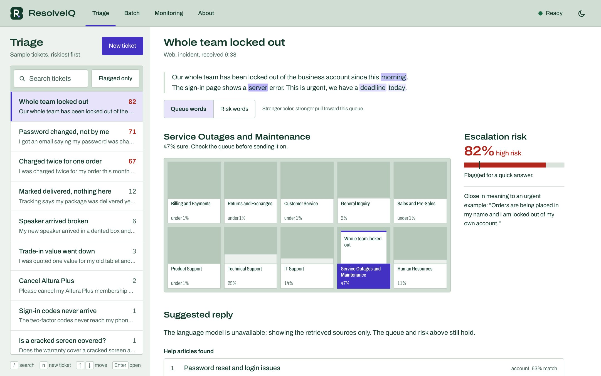
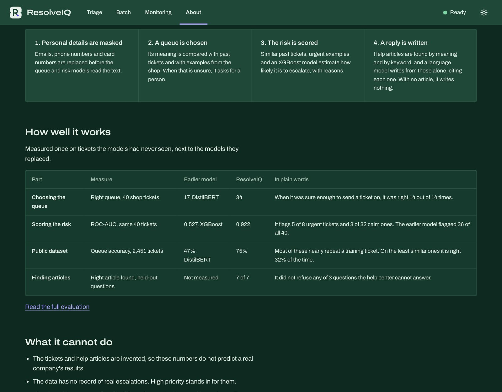
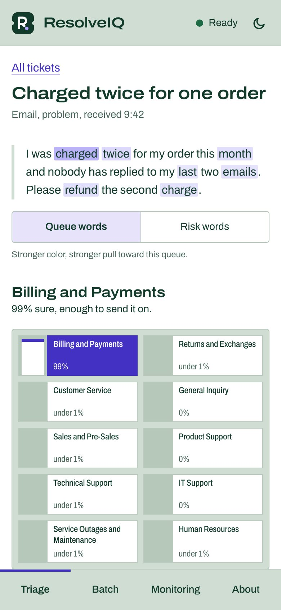

# Web App

The main user interface is a React and TypeScript single-page app in `frontend/`. FastAPI
serves the built files next to the API, so one process and one port run the whole
product. The Gradio page (`app.py`) stays as a lighter alternative.



## Design

The interface is designed as a triage instrument rather than a generic dashboard. The full
direction, tokens and motion rules are in [frontend/DESIGN.md](../frontend/DESIGN.md).

- **Verdict first.** After analysis, one strip answers where the ticket goes, how risky it
  is and whether a reply is ready; the evidence follows below.
- **Type with roles.** Instrument Serif for headlines and verdicts, Geist for interface
  text, Geist Mono with tabular digits for every number. The fonts are bundled with the
  app, so no request goes to a font service.
- **One signal color.** Lime marks focus, the primary action and the active page. Risk
  keeps its own green, amber and red scale.
- **Instruments, not charts.** The risk meter is a ruled 0 to 100 scale with the alert
  threshold marked, sources carry match bars, and response time is one proportional bar
  that also shows time spent outside the named steps.
- **Two themes.** Paper (light) and Night (dark) follow the system setting and can be
  switched from the rail.
- **Motion that explains change.** Results rise in sequence, meters fill and the risk
  number counts up once. All motion stops when the system asks for reduced motion.
- **Every screen size.** A navigation rail on desktop, a top bar on tablets and a bottom
  tab bar on phones; grids collapse to one column and tables scroll inside their card.

| Night theme, monitoring | Phone, analyze |
|---|---|
|  |  |

## Pages

| Page | What it does | API calls |
|---|---|---|
| Analyze | Ticket form with type, channel and product, a character counter, example tickets and Ctrl or Cmd + Enter to submit. The verdict, category and risk appear as soon as they are computed and the draft is written out live. Citations become numbered chips that jump to their source, with a grounding line. A Why card highlights the words behind the category or the risk in the ticket itself. Step timings and feedback buttons follow | `POST /analyze/stream`, `POST /feedback` |
| Batch | Drag and drop a CSV, download a sample file, see summary tiles and a ranked table with an alerts-only filter, export the ranking as CSV | `POST /batch` |
| Monitoring | Volume, alert rate, review rate, latency and negative feedback, distributions of categories and draft outcomes, and the 50 most recent requests with their feedback | `GET /stats`, `GET /requests` |

The navigation shows a live status from `GET /health` every 30 seconds (with model
versions on hover) and switches between the Paper and Night themes.

Behaviour worth knowing:

- A `503` from `/analyze` is shown as a partial result: the draft card explains that the
  language model is unavailable and still lists the retrieved sources, while the category
  and risk cards render normally.
- Validation errors from the API (empty text, unknown fields) are shown as readable
  messages. Text over 4,000 characters is blocked before it is sent.
- Pages are addressed by hash (`/#/batch`, `/#/monitoring`), so a refresh keeps the page
  and no server-side routing is needed.
- No ticket text is stored in the browser. The theme choice is the only thing saved, in
  local storage.

## Running it

Requires Node.js 20 or later.

```bash
make web-install   # npm ci in frontend/
make web-build     # type check and build into frontend/dist
make api           # http://127.0.0.1:8000 now serves the app and the API
```

For development with hot reload, run the API and the Vite dev server side by side:

```bash
make api           # terminal 1: API on port 8000
make web-dev       # terminal 2: app on http://127.0.0.1:5173, API calls proxied to 8000
```

Set `RESOLVEIQ_API_URL` to proxy to an API elsewhere. `VITE_API_BASE` (at build time)
points the built app at an API on another origin, and `VITE_SOURCE_BASE_URL` changes where
source links point.

## Structure

```
frontend/
  index.html               page shell
  vite.config.ts           dev proxy, build and test settings
  src/
    main.tsx               entry point
    App.tsx                rail, top bar and tab bar navigation, health status, theme
    index.css              design tokens for both themes and all component styles
    api/types.ts           response types mirroring src/resolveiq/schemas.py
    api/client.ts          fetch wrappers and ApiError
    lib/format.ts          formatting helpers (percent, durations, source titles, CSV)
    lib/examples.ts        example tickets and form limits
    components/            verdict strip, result cards, risk meter, timeline, logo
    lib/useCountUp.ts      number count-up that respects reduced motion
    pages/                 Analyze, Batch and Monitoring
    test/                  test setup and fixtures
```

There is no UI component library and no router: the app has three pages and a small
design system, and staying with React alone keeps the script at about 78 KB gzipped.

## Quality checks

```bash
make web-test      # oxlint, TypeScript type check and Vitest
```

Tests use Vitest, Testing Library and jsdom with `fetch` mocked. They cover the
formatting helpers, the API client (partial results, validation messages, an unreachable
server, unknown feedback IDs), the three result cards and the analyze flow from typing a
ticket to storing feedback. CI runs lint, type check, tests and a production build in a
separate `frontend` job.

When the API changes, update `api/types.ts` to match `schemas.py`; the type check then
shows every place that needs to change.
